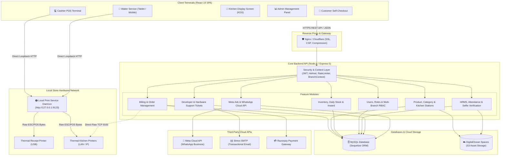
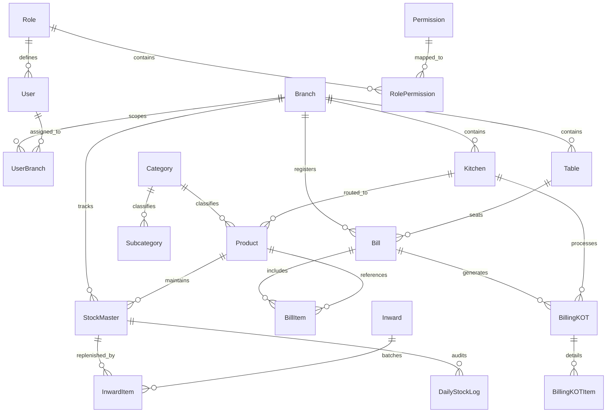
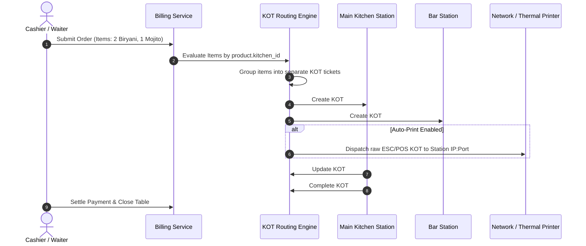
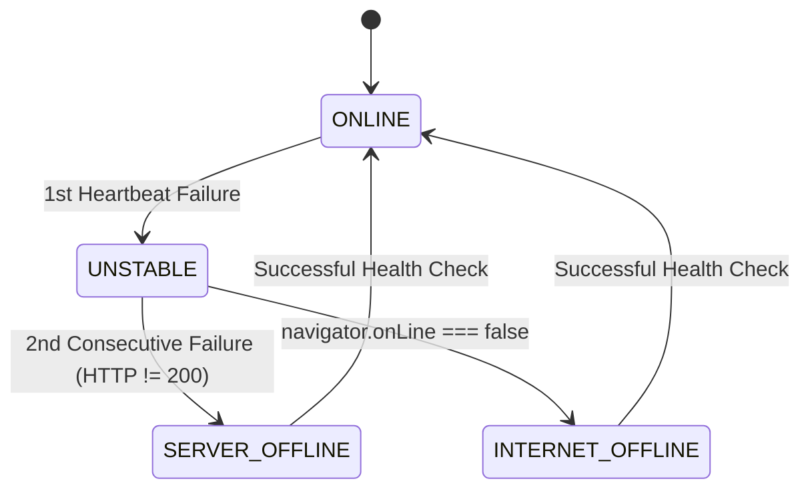

# 🏛️ Atelier General POS — System Architecture & Technical Design

This document provides a comprehensive technical specification of the **Atelier General POS** system architecture. It outlines the end-to-end design across frontend clients, the backend REST services, database models, the multi-station KOT routing engine, offline resilience, and hardware printing bridges.

---

## Table of Contents
1. [High-Level System Topology](#1-high-level-system-topology)
2. [Frontend Architecture (React 19 & Vite)](#2-frontend-architecture-react-19--vite)
3. [Backend Service Layer (Node.js & Express)](#3-backend-service-layer-nodejs--express)
4. [Database Architecture & Entity Relationships](#4-database-architecture--entity-relationships)
5. [Kitchen Routing Engine & KOT Lifecycle](#5-kitchen-routing-engine--kot-lifecycle)
6. [Restaurant Table & Available Table Algorithm](#6-restaurant-table--available-table-algorithm)
7. [Security, Authentication & RBAC Model](#7-security-authentication--rbac-model)
8. [Offline Resilience & Network Outage Detection](#8-offline-resilience--network-outage-detection)
9. [Hardware Printing Bridge (Local Print Service)](#9-hardware-printing-bridge-local-print-service)
10. [Production Deployment & Scalability](#10-production-deployment--scalability)

---

## 1. High-Level System Topology



---

## 2. Frontend Architecture (React 19 & Vite)

### 2.1 Technology Foundation
- **Framework**: React 19 with Vite 6 for optimized Hot Module Replacement (HMR) and tree-shaking.
- **UI & Layout**: Ant Design 5 (antd) component library layered with TailwindCSS utilities and Framer Motion micro-animations.
- **Design Tokens**: Standardized 8px grid system, WCAG AA compliant contrast ratios, and adaptive light/dark sidebar palettes.

### 2.2 Modular Routing Architecture
The application uses an eager auto-discovery module loader in [`App.jsx`](file:///d:/Atelaier/general-pos/frontend/src/App.jsx):
```javascript
const routeModules = import.meta.glob('./*/AppRoutes.jsx', { eager: true });
```
Each functional domain lives in its own folder with a self-contained `AppRoutes.jsx` exporting both route definitions and menu navigation items.

### 2.3 Context Provider Pipeline
The global application state is structured in hierarchical React Contexts:
```
ConfigProvider (Ant Design Theme)
 └── BrowserRouter
      └── AuthProvider (Admin / Cashier JWT State)
           └── EmployeeAuthProvider (HRMS / Staff State)
                └── BranchProvider (Active Branch Selection & Multi-tenancy)
                     └── NetworkProvider (Online / Offline Heartbeat Sentinel)
                          └── Application Routes & Lazy Modals
```

---

## 3. Backend Service Layer (Node.js & Express)

### 3.1 Layered Architecture Pattern
The backend enforces a strict separation of concerns across 4 distinct layers:
1. **Route Layer (`*.routes.js`)**: Maps endpoints, attaches path parameters, and enforces authentication and RBAC authorization guards.
2. **Middleware Layer (`middleware/*.js`)**:
   - `verifyToken`: Decodes and validates JWT claims.
   - `authorize(permissions)`: Evaluates fine-grained role permissions.
   - `branchContext`: Extracts `x-branch-id` headers or user branch affinity.
   - `globalLimiter`: IP-based rate limiting to prevent DDoS.
   - `xssSanitizer`: Strips malicious HTML/JS payloads.
3. **Controller Layer (`*.controller.js`)**: Validates input schemas, coordinates service invocations, formats standard responses via `res.sendSuccess` / `res.sendError`.
4. **Service & Model Layer (`*.service.js` & `*.model.js`)**: Executes business rules, triggers Sequelize ORM transactions, and manages atomic database operations.

---

## 4. Database Architecture & Entity Relationships



---

## 5. Kitchen Routing Engine & KOT Lifecycle

### 5.1 Real-Time Station Routing
When an order is submitted from a POS Terminal or Waiter Tablet, the billing service automatically segregates ordered items based on each product's configured `kitchen_id`:



### 5.2 KOT State Machine
```
[PENDING] ──────> [PREPARING] ──────> [READY] ──────> [SERVED]
    │                 │
    └─────────────────┴─────────────> [CANCELLED] (Requires reason + inventory audit)
```

### 5.3 SLA & Overdue Order Detection
Each kitchen station defines a `default_prep_time` (e.g. 15 minutes). The KDS screen and administrative metrics continuously monitor elapsed preparation time:
$$\text{Elapsed Time} = \text{Current Time} - \text{KOT Created Time}$$
If $\text{Elapsed Time} > \text{SLA Duration}$, the KOT card pulses with visual warning tags and delay alerts.

---

## 6. Restaurant Table & Available Table Algorithm

To eliminate accidental duplicate orders in high-volume dining establishments, table allocation strictly adheres to the following algorithm:

1. **Active Order Check**: A table cannot accept a new order if it currently has an unpaid or active order attached.
2. **Next Available Table Finder**:
   ```sql
   SELECT t.* FROM tables t
   WHERE t.branch_id = :branchId
     AND t.is_active = true
     AND t.id NOT IN (
         SELECT b.table_id FROM bills b
         WHERE b.branch_id = :branchId
           AND b.payment_status != 'PAID'
           AND b.order_status NOT IN ('COMPLETED', 'CANCELLED')
     )
   ORDER BY t.table_number ASC;
   ```

---

## 7. Security, Authentication & RBAC Model

### 7.1 Dual-Token JWT Lifecycles
- **Access Token**: Short-lived (15 minutes), containing user ID, role, permissions, and active branch context.
- **Refresh Token**: Long-lived (7 days), stored securely and rotated upon renewal.

### 7.2 Third-Party Token Encryption
External tokens (such as Meta Cloud API system user tokens) are stored in the database encrypted via **AES-256-GCM** with initialization vectors (`IV`) and authentication tags:
$$\text{Encrypted Payload} = \text{AES-256-GCM}(\text{Secret Key}, \text{Token}, \text{IV})$$

### 7.3 Multi-Tenancy Isolation
Every database query against operational data (`bills`, `products`, `kitchens`, `stock`, `employees`) enforces branch isolation:
```javascript
where: {
  branch_id: req.branchContext.branchId
}
```

---

## 8. Offline Resilience & Network Outage Detection

### 8.1 Dual-Stage Health Check Pipeline
The frontend `NetworkStatusNotifier` monitors network integrity via:
1. Native browser events (`window.addEventListener('online' | 'offline')`).
2. Periodic asynchronous heartbeats (`GET /api/v1/health` with a 3.5s timeout).



### 8.2 Data Safety Under Outage
When an outage is detected:
- The UI displays an alert banner without blocking screen interaction.
- Active shopping carts, unsaved KOTs, and table selections are preserved in React state.
- Accidental repeated payment or double-checkout requests are prevented.

---

## 9. Hardware Printing Bridge (Local Print Service)

### 9.1 Browser-to-Hardware Barrier
Web browsers enforce strict sandbox constraints that prevent client-side JavaScript from accessing USB ports or dispatching raw TCP packets to thermal printers.

### 9.2 The Solution: Local Print Bridge Daemon
An ultra-lightweight Node.js service runs on `http://127.0.0.1:9123` on the cashier station:

```
[Browser Client]
       │
       ▼ (HTTP POST /print json)
[Local Print Daemon: 9123]
       │
       ▼ (ESC/POS Binary Generation)
[Raw Thermal Printer (USB / 9100 TCP)]
```

- **Receipt Layout**: 80mm & 58mm thermal templates, restaurant header, itemized tax invoice, QR code payment links, and GS28 cutting commands.
- **Silent Print**: Zero browser print dialogues or manual confirmation required.

---

## 10. Production Deployment & Scalability

### 10.1 Recommended Infrastructure Stack
| Component | Production Standard | Staging / Development |
|---|---|---|
| **Frontend** | Vercel / Nginx + Cloudflare CDN | Vite Dev Server (`localhost:5173`) |
| **Backend** | Docker / Node.js Cluster with PM2 | Node.js (`localhost:10000`) |
| **Database** | Managed MySQL 8.0+ / MariaDB (Connection Pool 25-50) | Local MySQL Instance |
| **Object Storage** | DigitalOcean Spaces / AWS S3 (CDN enabled) | DigitalOcean Spaces |
| **Process Monitoring** | PM2 Process Manager | nodemon |

### 10.2 Production Performance Checklist
- ✅ Gzip / Brotli compression enabled in Nginx.
- ✅ Preflight caching configured with `maxAge: 86400` in CORS.
- ✅ Content Security Policy (CSP) headers managed via Helmet.
- ✅ Database indexes added to `branch_id`, `created_at`, `status`, and `table_id`.
